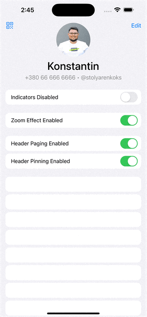

# Dynamic Island SwiftUI Demo like Telegram
An example of a custom animation of the user's avatar smoothly flowing and dissolving into the Dynamic Island, following the example of how it is done in Telegram. 
Developed entirely natively using Swift and SwiftUI.

## Installation
All dependencies are managed by SPM automatically.

## Build
No additional setup is needed. Build project using Xcode.

## Technologies
* Swift
* SwiftUI

## Versions
* Xcode 27.0 (latest)
* Swift 5

## Supported Devices
iPhone only, iOS 16.4 and later.

* iPhone 8, iPhone SE, etc. (no notch or Dynamic Island: the avatar shrinks and fades out)
* iPhone X – iPhone 14 Plus, iPhone 16e, iPhone 17e (notch: the avatar flows into the notch)
* iPhone 14 Pro – iPhone 17 Pro Max, iPhone Air (Dynamic Island: full functionality)
* iPhone 18 Pro, iPhone 18 Pro Max (smaller Dynamic Island: full functionality)

## Branches
GitFlow is strictly enforced on this repository. [GitFlow](https://www.atlassian.com/git/tutorials/comparing-workflows/gitflow-workflow)

### Branch overview
* master
* develop
* feature/name
* hotfix/name

### Git Flow:
feature -> develop -> master

## License
Copyright © October 18, 2026 Konstantin Stolyarenko. All rights reserved.
